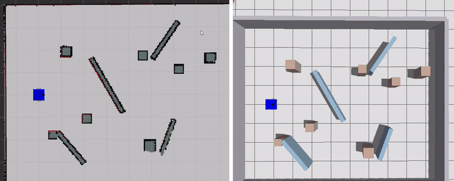
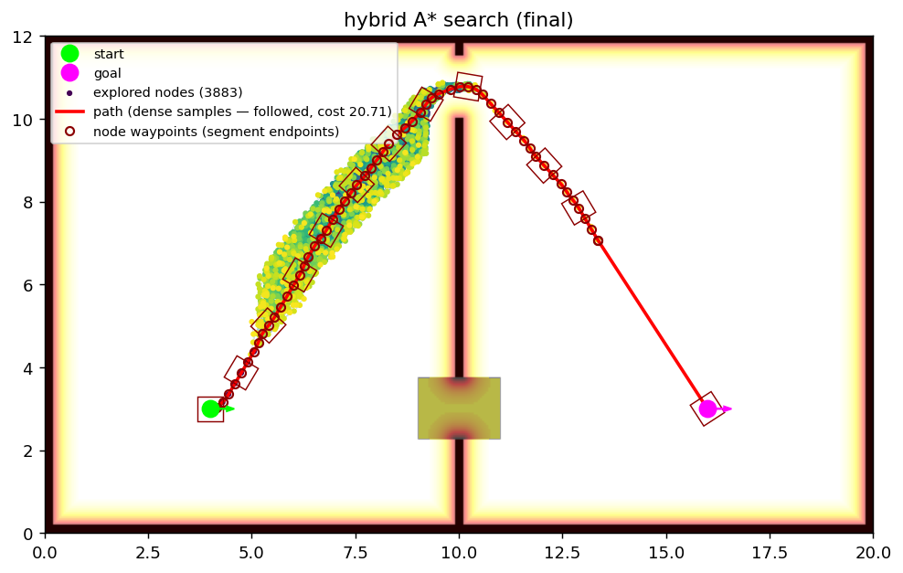
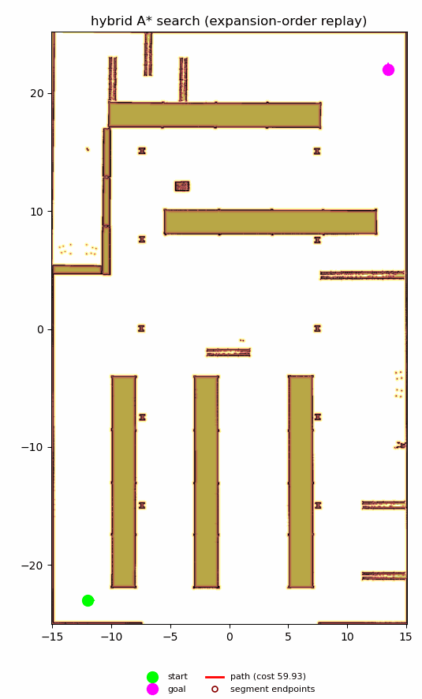

# Autonomous_Nav_Planar

[](https://github.com/seifelshafey-dev/Autonomous_Nav_Planar/actions/workflows/ci.yml)
[](LICENSE)


A hybrid A* path planner for differential-drive robots, with a ROS 2 navigation stack built around it.



*The planner driving the reference robot in simulation: RViz on the left, Gazebo on the right. The goal is set at normal speed, the drive is shown at 4x.*

## Overview

The planner searches in continuous SE(2). Motions are short `(v, ω, dt)` controls computed once at startup, each with the grid cells its footprint can sweep, so a collision check during the search is a table lookup instead of a polygon rasterization. The core is plain C++20 with no ROS dependency; the ROS 2 nodes are a thin layer on top.

What you get:

- A planner library that takes a start, a goal and an occupancy grid, and returns a drivable path or a reason why there is none.
- A ROS 2 stack around it: a map provider, a planner action server, a navigator that replans as the map changes, a pure-pursuit follower, and a lidar guard that stops the robot before it touches anything.
- A scenario format and a visualizer for running the planner on a map without ROS.
- A reference robot and Gazebo worlds to try the whole thing in simulation.

What it is not:

- It is not a state lattice. States are never snapped to a grid; the grid is only used to detect duplicates and to cache footprints.
- It is not a navigation framework. There are no behavior trees, plugins or recovery behaviors beyond one straight escape move.
- The robot model in `robot_bringup` is an example. The planner does not depend on it, and you are expected to bring your own robot.



*Two rooms joined by a door in mapped space (top) and one in unmapped space (bottom). The dots are the states the search expanded, the red line is the path it returned.*



*The same planner on a larger map, a warehouse about 30 m by 50 m. The animation replays the search in the order the states were expanded, then shows the path it returned. The map is the warehouse map from Nav2's `nav2_bringup` package (Apache-2.0) and is not included in this repository.*

## Requirements

- Docker with the Compose plugin. The image carries ROS 2 Humble, GCC 12 and every dependency, and it is the environment CI uses.
- About 10 GB of disk for the two images.

A host build on Ubuntu 22.04 also works; see [getting started](docs/guide/getting-started.md).

## Quick start

```bash
git clone https://github.com/seifelshafey-dev/Autonomous_Nav_Planar.git
cd Autonomous_Nav_Planar

# Build the image, then the workspace inside it
docker build -f docker/Dockerfile --target ci -t planner-ci .
docker compose -f docker/compose.yaml run --rm dev \
  bash -c 'colcon build --executor sequential --cmake-args -DCMAKE_BUILD_TYPE=Release -DBUILD_TOOLS=ON'
```

The build takes about five minutes. Sources are mounted from your checkout; build output stays in Docker volumes, so nothing lands in the tree.

### Plan a path

Run the planner on one of the test scenarios and render the search:

```bash
docker compose -f docker/compose.yaml run --rm dev bash -c '
  cd src/path_planner &&
  /ws/build/planner/tools/search_viz_dump test/integration/scenarios/known_door_preferred.yaml &&
  python3 tools/viz/plot_search.py tools/viz/output/known_door_preferred.json'
```

The picture is written to `src/path_planner/tools/viz/output/known_door_preferred.png`. To write your own scenario, see the [scenario guide](docs/guide/scenarios.md).

### Run the tests

```bash
docker compose -f docker/compose.yaml run --rm dev \
  bash -c 'colcon test --executor sequential && colcon test-result --verbose'
```

For a quick check, add `--packages-select planner --ctest-args -L fast`. The lanes and labels are described in the [testing guide](docs/guide/testing.md).

### Run the simulator

```bash
docker build -f docker/Dockerfile --target sim -t planner-sim .
docker compose -f docker/compose.yaml run --rm sim \
  bash -c 'source install/setup.bash && ros2 launch robot_bringup sim_system.launch.py world:=cluttered_demo.sdf'
```

This uses the workspace built in the quick start above. It starts Gazebo, SLAM, the planner stack and the reference robot. Publish a `geometry_msgs/PoseStamped` on `/goal_pose` (the "2D Goal Pose" tool in RViz does this) and the robot drives there, mapping as it goes. Inside the container the simulator runs headless with software rendering. On a host install, add `gui:=true rviz:=true`.

`cluttered_demo.sdf` and the three TurtleBot 4 worlds are the ones worth using. SLAM needs features to hold a pose, and a nearly empty world does not give it any.

## How the stack fits together

| Piece | What it does |
|---|---|
| Map provider | Turns each SLAM occupancy grid into an immutable snapshot with a distance field. |
| Planner server | A cancellable `PlanPath` action that runs one search on the latest snapshot. |
| Navigator | Owns the goal. Decides when to plan, follow, replan, back out of a blocked start, or give up. |
| Follower | Pure pursuit on the planned path. Each pose carries a mode: drive forward, reverse or pivot. |
| Scan guard | Sits between the follower and the wheels and zeroes the command when the lidar sees something inside the stopping zone. |

The planner core lives in `src/path_planner/include/core`, the nodes in `src/path_planner/include/ros`, the messages in `src/path_planner_msgs`, and the example robot in `src/robot_bringup`.

## Documentation

- [Getting started](docs/guide/getting-started.md): from a clone to a first plan and a first change.
- [Architecture](docs/architecture/overview.md): the modules, the ROS interfaces and the configuration files.
- [Design notes](docs/design/README.md): why the planner is built this way, with the derivations behind each bound.
- [Dev journey](docs/dev-journey.md): what went wrong along the way and what I changed because of it.
- API reference: run `mkdir -p build && doxygen` from the repository root and open `build/docs/html/index.html`.

## Known limitations

- Footprints must be convex polygons.
- Paths are not guaranteed to be the cheapest. The heuristic can overestimate by about 8%, and the first direct connection to the goal that fits is taken even when a cheaper route exists.
- There is no hard bound on how far the robot strays from the planned path. The scan guard is a backstop, not a guarantee.
- The guard sizes its stopping zone from the commanded speed, not the measured one.
- The planner can route closer to a wall than the guard's side margin allows, and the guard then holds the robot in place.
- A new obstacle only enters the map once the robot has moved while seeing it. That comes from the SLAM front end.
- Driving to a goal outside the mapped area works in simple worlds and is not yet reliable in cluttered ones.
- Tested on ROS 2 Humble and in simulation only. It has not been run on a physical robot.

## How it got here

The simulator is where most of my assumptions failed. A safety stop that left the robot a couple of centimetres inside a wall made every later replan fail, because the planner refused a start in collision. My first fix let the planner start in collision, and that disagreed with the path monitor and set off an endless stream of replans. I replaced it with a simpler rule: move straight out to free space first, then plan from a clear start. The full story, including the collision cache I had to rebuild, is in the [dev journey](docs/dev-journey.md).

## Contributing

Issues and pull requests are welcome. Read [CONTRIBUTING.md](CONTRIBUTING.md) first; it is short.

## License

Apache-2.0, see [LICENSE](LICENSE). The `tb4_*` worlds are copied from the TurtleBot 4 simulator, also Apache-2.0; their notice is in `src/robot_bringup/worlds/THIRD_PARTY_LICENSE.turtlebot4`.
