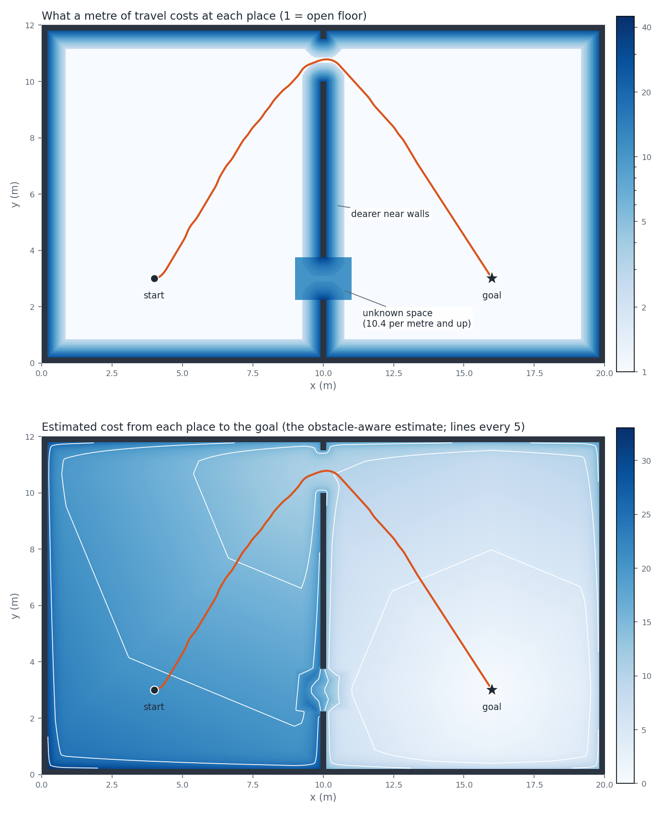

# Cost and heuristic

The search adds up one number per motion and tries to keep the total small. Two things shape that number: how far and how much the robot moves, and how close to a wall it does it. A third piece, the heuristic, estimates what is left to pay and decides which states the search looks at first. This page covers all three, and where the estimate is wrong.

## What the search minimises

Every motion from [the primitives page](primitives.md) has a price. A path costs the sum of the prices of its motions, plus the price of the analytic finish to the goal if one is used. The search expands states in order of the cost paid so far plus an estimate of the cost still to pay.

Notation:

```
w      costmap_weight (shipped 1.0)
h      map resolution (m)
r_in   radius of the largest circle inside the footprint (0.3 m for the shipped 0.6 m square)
r_out  radius of the smallest circle around the origin that contains the footprint
rmin   minimum turning radius (m)
```

## The cost of a motion

```
cost = sqrt(v² + rmin²·ω²)·dt  +  w · mean(c) · |v|·dt
```

The first term is the motion cost from the primitives page. In the second, `c` is the cost-map value (next section), `mean(c)` is its average over the poses sampled along the motion (three for the straight one: start, middle and end), each looked up in the cell under the robot's centre, and `|v|·dt` is the distance travelled. Each primitive stores those cells per heading bin, computed at the middle of the bin from the corner of a cell, and shifted by the cell the robot is in. A pivot travels no distance, so it pays nothing for where it stands.

Taking the mean and multiplying by distance makes the penalty a rate per metre. It does not grow with the number of samples. The analytic finish to the goal is charged the same way over its own sampled poses.

This is the expansion loop and `HybridAstar::shotAtGoal` in `src/path_planner/src/core/planner/hybrid_astar/search.cpp`. The motion term is checked on the primitives page. I did not find a test that checks the second term against a hand-computed value, on either the expansion or the shot; `HybridAstarSearch.unknownPenaltyRaisesPathCost` (`src/path_planner/test/unit/core/planner/hybrid_astar/search_test.cpp`) only checks that a dearer cost map gives a dearer path.

## The cost map: dearer near walls

`buildCostMap` gives every cell a number from its distance `d` to the nearest occupied cell, taken from the distance map:

```
c = max_clearance_cost · exp(-clearance_decay · d)     if d < clearance_radius
c = 0                                                  otherwise
```

Shipped: 30, 4.5 per metre and 0.70 m. With `w = 1` a metre of travel costs `1 + w·c`:

| Distance to the nearest wall | Cost of a metre |
|---|---|
| 0.70 m or more | 1.0 |
| just under 0.70 m (the edge of the band) | 2.3 |
| 0.50 m | 4.2 |
| 0.30 m | 8.8 |

An occupied cell has `d = 0`, so it holds the maximum. That is only a price. Whether a motion collides is decided by the collision check described in [the swept-cell cover](swept-cover.md). `buildHybridAstar` requires `clearance_radius > r_out` and throws otherwise, because a band that ends inside the footprint's reach would stop pushing the path away from a wall exactly where it matters.

Checked by `BuildCostMap.clearanceInflationAcrossTheBand`, `BuildCostMap.decayShapesTheInflation` and `BuildCostMap.occupiedCellGetsMaxClearanceAndNoUnknown` (`src/path_planner/test/unit/core/planner/cost/costmap_test.cpp`), which compare cells at known distances with the formula, and by the property `CostMapProp.clearanceIsMonotoneNonIncreasingInEDT` (`costmap_property_test.cpp`, same folder). The radius check is tested by `BuildHybridAstar.clearanceRadiusMustExceedCircumscribedRadius` (`src/path_planner/test/unit/core/planner/hybrid_astar/build_hybrid_astar_test.cpp`), which tries the largest float not above `r_out` (throws) and the next float up (accepted).

## Unknown space

A cell the map has not seen gets an extra price `u` on top of its clearance cost, and every place outside the map costs exactly `u` (`CostMap::costAt`). I did not want to pick `u` by hand, because the right value depends on the robot and the grid. I pick a ratio instead:

```
d_min = max(0, r_in - (√2/2)·h)
b     = max_clearance_cost · exp(-clearance_decay · d_min)      (0 if d_min ≥ clearance_radius)
u     = (unknown_cost_factor · (1 + w·b) - 1) / w               (0 if w = 0)
```

Rearranged, `1 + w·u = unknown_cost_factor · (1 + w·b)`. The distance map is measured from cell centres to the centres of occupied cells. A pose that passes the collision check has no occupied cell centre inside the footprint, so every one is at least `r_in` from the robot's centre, and that centre is at most `(√2/2)·h` from the centre of its own cell. So the distance-map value there is at least `d_min`, and `1 + w·b` is an upper bound on what a metre costs in the cell under the centre of a collision-free robot. A metre of unknown space costs `unknown_cost_factor` times that. The factor must be at least 1, and loading fails otherwise, so a metre of unknown space is never priced below that bound. A ratio keeps its meaning if the robot or the grid changes.

The bound is on the cell under the true centre. The search charges the sampled cells described above, which can sit a little nearer a wall, and I have no proof that the mean over a motion stays under the bound.

Shipped, with a factor of 1.03 on a 0.05 m map: `d_min` is 0.2646 m, `b` is 9.118 and `u` is 9.422. A metre of unknown space costs about 10.4, against 1 on open floor.



*Two panels of the same scenario: two doors in a wall, the near one inside a patch of unknown space. Top: the cost of a metre of travel at each place, 1 on open floor. Walls are dark, the glow is the clearance cost and the rectangular patch is unknown space. The orange line is the path the planner found, which goes round by the far door. Bottom: the obstacle-aware estimate from every place to the goal, with a line every 5. The lines are octagons, not circles, which is the error described below made visible.*

Checked by `BuildCostMap.unknownCostFollowsFormulaForWeightOneAndHalf`, `BuildCostMap.zeroCostmapWeightGivesZeroUnknownCost` and `BuildCostMap.factorOneGivesUnknownCostEqualToDearestFreeCost` (`costmap_test.cpp`), and by `ShippedConfig.unknownCostIsDerivedFromFactorAndNeverBelowFreeSpace` (`src/path_planner/test/integration/shipped_config_test.cpp`) for the shipped numbers. The first pins `u = 9.422` for the shipped values. The properties `CostMapProp.unknownPenaltyIsExactlyAdditive` and `CostMapProp.unknownCostBoundsFreeSpaceCost` (`costmap_property_test.cpp`) check that `u` is added on top of the clearance cost and that no known cell with a distance of `d_min` or more costs more than `u`. The factor of at least 1 is checked by `LoadCostPolicy.throwsOnAnyInvalidField` (`src/path_planner/test/unit/core/config/config_loader_test.cpp`).

## The estimate to the goal

`MaxHeuristic`, wired up in `buildHybridAstar`, takes the larger of two estimates, each already multiplied by `heuristic.weight`:

```
estimate = max(weight · straight_line,  weight · obstacle_aware)
```

With `use_obstacle_heuristic: false` only the straight-line estimate is used.

**Straight line.** `PointsWeightedEuclideanSE2` with weight `rmin²`:

```
sqrt(Δx² + Δy² + rmin²·Δθ²)        Δθ wrapped to [-π, π]
```

It ignores obstacles. It never exceeds the true cost of reaching the exact goal pose. The cost of a path is the integral of the length of the vector `(v·cosθ, v·sinθ, rmin·ω)`. The integral of a vector's length is at least the length of its integral. That integral is `(Δx, Δy, rmin · total turn)`, and the total turn is at least the wrapped `|Δθ|`. The cost-map term only adds.

**Obstacle-aware.** `ObstacleHeuristic` is the cheapest route from the state's cell to the goal's cell over the grid. Moves go to the eight neighbours, and each step costs `step · (1 + w·c)`, where `step` is `h` or `√2·h` and `c` is the cost of the cell being stepped into as the route grows out from the goal. So the goal's own cell is free and every other cell on the way is paid for. Occupied cells block. Unknown cells can be crossed at their price. The robot is a point here. The route is computed outward from the goal only as far as the queries need, and the values do not depend on the order of the queries. Only the goal's cell matters, not where the goal sits inside it or which way it points.

It returns 0, leaving the decision to the straight-line estimate, when the state is outside the map, or when the goal is outside the map or on an occupied cell. For a cell with no route to the goal it returns a very large finite number, so those states sink to the bottom of the queue without making the arithmetic overflow.

Checked by `DistanceHeuristic.accountsForWeightedHeading`, `DistanceHeuristic.multipliesRawDistanceByWeight` and `MaxHeuristic.returnsTheLargerChild` (`src/path_planner/test/unit/core/planner/hybrid_astar/heuristics_test.cpp`), and `PointsWeightedEuclidean.angularDeltaIsWrappedToShortestArc` (`src/path_planner/test/unit/core/motion/distance_functions_test.cpp`). For the obstacle-aware estimate: `ObstacleHeuristicDial.freeGridMatchesHandComputedOctileDistance`, `ObstacleHeuristicDial.matchesIndependentBellmanFordWithWallAndCostmap` and `ObstacleHeuristicProp.bellmanOptimalityWithCostmap` check the field against hand and independent computations and confirm that the entered cell is the one charged. `ObstacleHeuristic.occupiedAndWalledOffAndOffGridCellsAreUnreachable`, `ObstacleHeuristic.operatorPrunesInGridUnreachableCell`, `ObstacleHeuristic.operatorAbstainsForOffGridState`, `ObstacleHeuristic.operatorAbstainsEntirelyWhenGoalOffGrid` and `ObstacleHeuristicLazy.offGridOrOccupiedGoalIsInactive` check the cases above, and `ObstacleHeuristicProp.lazyFieldAtBitwiseEqualsFullBuildAnyOrder` checks that the order of the queries does not matter (all in `src/path_planner/test/unit/core/planner/hybrid_astar/obstacle_heuristic_test.cpp` and `obstacle_heuristic_property_test.cpp`).

## The estimate can be too high

Eight-direction steps cannot follow a straight line at every angle. Along a line at angle `φ` to an axis, the grid route has length `max + (√2 - 1)·min` of the two offsets, which is `cos φ + (√2 - 1)·sin φ` per unit of straight-line length. That is largest at `tan φ = √2 - 1`, 22.5° off an axis, where it equals `sqrt(4 - 2√2) = 1.0824`. So where the cost map is zero, the obstacle-aware estimate between two cell centres is at most 8.24% above their straight-line distance. With a non-zero cost map or obstacles I state no bound, and the estimate is measured between cell centres, so it can differ from the state's own distance by up to about one cell.

On an open grid the real code gives a worst ratio of 1.08239 at 67.5006 degrees, the same angle seen from the other axis. In the scenario in the figure the estimate at the start is 20.81 and the straight-line estimate is 12, while the path the planner then found costs 20.71. The estimate at the start is above the cost of a path that exists.

The consequence: with `weight` 1.0 the search is not guaranteed to return the cheapest path, and I accepted that. I give no bound on how much dearer the returned path can be. The duplicate rule from [the primitives page](primitives.md) already removes that guarantee on its own, since it drops a candidate when an expanded state in the same duplicate cell and heading bin already has a cost no higher, even if the candidate would have led to a cheaper route.

The ratio and the scenario numbers were measured with `cost_field_dump`, described on the tools page. No test pins them: `ObstacleHeuristic.freeGridApproximatesStraightLineAndIsMonotone` only checks that the field stays between the straight-line distance and `√2` times it. The bound argument for `d_min` and the straight-line lower bound above have no test either.

## Limits

- The obstacle-aware estimate can be up to 8.24% above the straight-line distance where the cost map is zero; with a non-zero cost map or obstacles I state no bound.
- The straight-line estimate is measured to the exact goal pose, while the search stops anywhere inside the goal tolerance (`goal_pos_tol` for position, `goal_heading_tol` for heading). Next to the goal it can be as much as `sqrt(0.10² + (0.3·0.10)²)` = 0.104 too high on the shipped values. The obstacle-aware estimate has the same flaw: inside the tolerance but outside the goal's cell it is still about `0.10·(1 + w·c)`.
- The obstacle-aware estimate drops to 0 as soon as a state steps off the map, so the combined estimate falls to the straight-line value at the map border.
- The obstacle-aware estimate ignores the robot's size, so it can route through a gap the robot does not fit. The search then finds out by expanding into it.

To redraw the figure, see "Redraw the cost and heuristic figure" in [the tools page](../../src/path_planner/tools/viz/README.md).
