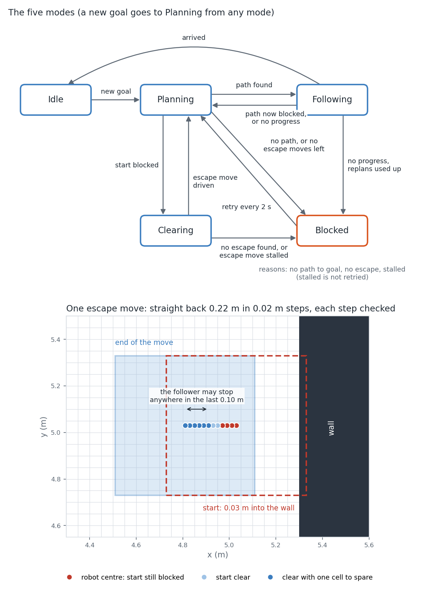

# Navigation

The planner answers one question: is there a path from here to there. Something has to decide when to ask, when to drive, what to do when the answer is no, and when to stop trying. That is the navigator. This page covers its modes, the numbers it works out for itself, the rule that calls a robot stalled, and the short move it makes to get out of a blocked start.

## What the navigator does

The logic lives in `NavigationMode` (`src/path_planner/include/core/navigation/navigation_mode.hpp`, `src/path_planner/src/core/navigation/navigation_mode.cpp`). It holds no clock, no threads and no I/O. It takes events with a monotonic timestamp (a goal, a plan reply, a map change, progress from the follower, a tick) and returns actions (request a plan, cancel it, publish a path, publish a stop, run the escape search, report a change of state or reason). The ROS node `Navigator` (`src/path_planner/src/ros/navigator/navigator.cpp`) feeds it and carries the actions out, so the whole decision logic can be tested without ROS.

## The five modes

| Mode | Meaning |
|---|---|
| Idle | No goal. |
| Planning | A plan request is out. |
| Following | A path to the goal is being driven. |
| Clearing | An escape move is being driven. |
| Blocked | Given up for now, with a reason: no path to goal, no escape, or stalled. |

What moves between them:

| From | Event | What happens |
|---|---|---|
| any | new goal | The outstanding request is cancelled and a new one made; mode becomes Planning. A path already being driven keeps being driven until the new plan arrives. |
| Planning | plan found | The path is published; Following. |
| Planning | start blocked | The robot is stopped and the escape search runs; Clearing. After `max_clearing_attempts` escape moves for this goal, Blocked (no escape) instead. |
| Planning | goal blocked, no path, budget exhausted | Stop; Blocked (no path to goal). |
| Planning | `Stopped` reply | Stop; Idle. |
| Planning | no reply within `plan_reply_timeout` | Request cancelled, robot stopped; Blocked (no path to goal). A late reply is ignored. |
| Planning | arrival on the driven path, same goal | Request cancelled; Idle. For an older goal it is ignored. |
| Following | arrival | Idle. |
| Planning | the path still being driven is blocked nearer than `stop_distance` (checked on a map change, and on every tick while the replan is out) | The robot is stopped. |
| Following | map changed and the rest of the path is blocked | A new plan is requested; Planning. If the blockage is nearer than `stop_distance` the robot is stopped first. |
| Following | no cursor change for `stall_timeout` | Stop and replan, or Blocked (stalled) once `max_stall_replans` is used up. |
| Clearing | escape found | The move is published. Not found: Blocked (no escape). |
| Clearing | escape move arrived | Replan; Planning. |
| Clearing | escape move makes no progress for `stall_timeout` | Stop; Blocked (no escape). |
| Blocked | tick or map change, `blocked_retry_period` since the last request | Request a plan; Planning. Not for Blocked (stalled). |

In the figure, "no path" on the Planning to Blocked arrow stands for every reply that is not found, start blocked or stopped (goal blocked, no path, budget used up). It also stands for a found path that fails the check against the newest map when the reply arrives.



*Top: the five modes and what moves between them (a new goal goes to Planning from any mode; left out and described in the text: a `Stopped` reply and an arrival during a replan return to Idle, a request with no reply goes to Blocked, and waiting too long for the robot to come to rest before an escape goes to Blocked). Bottom: one escape move from the real search. A robot standing 0.03 m into a wall backs out 0.22 m in 0.02 m steps. Red dots are robot centres where the start check still fails, light blue where it passes, dark blue where it passes with a cell to spare. The follower may stop anywhere in the last 0.10 m, so the move is long enough for the earliest of those poses to have the spare cell.* The top panel is drawn by hand from the transition code; the bottom panel is drawn from the output of a tool.

Two counters bound how much the robot moves without success, and a period limits how often a blocked goal is retried. At most `max_clearing_attempts` (shipped 2) escape moves are driven per goal between two found plans (the node answers each escape request once); a search that finds no move does not count, an escape move that stalls still counts, and a found plan or a new goal resets the count. At most `max_stall_replans` (shipped 4) replans follow stalls per goal; the next stall ends in Blocked (stalled). A change of cursor restarts the stall timer but not the count; a new goal or an arrival resets it. A blocked goal is retried every `blocked_retry_period` (shipped 2.0 s), on a tick or a map change once that time has passed. Blocked (stalled) is not retried: only a new goal leaves it. A blocked goal is retried for as long as the goal stands. Nothing bounds the number of retries, or the number of replans caused by map changes.

Checked in `src/path_planner/test/unit/core/navigation/navigation_mode_test.cpp`, which drives the machine with scripted events and compares the actions returned. For the transitions: `Nav.Rule1GoalLeavesDrivenPlanRunning`, `Nav.Rule6StoppedGoesIdle`, `Nav.PlanningTimesOutWithoutReply`, `Nav.LateReplyAfterTimeoutIsIgnored`, `Nav.Rule8ArrivalDuringReplanForSameGoal`, `Nav.Rule13EscapeArrivedReplans`. For the counters: `Nav.Rule4ClearingLoopGivesUpOnThirdStartBlocked`, `Nav.FoundResetsClearingCount`, `Nav.EscapesNotFoundAreNeverCounted`, `NavStall.TwoReplansThenBlockedStalled`, `NavStall.CursorChangeDoesNotResetCount`, `NavStall.StalledIsNotRetriedOnTheTimer`, `Nav.Rule15BlockedRetry`.

## Numbers the navigator works out for itself

Two values are not in the config. The `Navigator` constructor computes them from the controller, planner and navigator settings:

```
stop_distance      = v_cruise · (max_plan_time_sec + tick_period_sec)     0.5 · (5.0 + 0.5) = 2.75 m
plan_reply_timeout = max_plan_time_sec + stall_timeout                    5.0 + 5.0 = 10 s
```

When the map changes, and on every tick while a replan is out, `checkRemainingPath` looks at the driven path from the sample nearest the robot onward. If something on it is now blocked, the robot keeps driving while a new plan is computed, unless the blockage is nearer than the distance the robot covers during that replan plus one tick. In that case it is stopped first. The comparison is strict: a blockage exactly `stop_distance` away does not stop the robot. The reply timeout is the longest the planner can legitimately take plus the time I allow before calling a robot stalled. The constructor also throws if `v_cruise` is above the planner's `vmax`, because the planner's motions are built at `vmax` and the follower must not be asked to go faster than they assume.

Checked by `Nav.Rule10AtStopDistanceNoStop` for the strict comparison, `Nav.Rule7PlanningMapChanged` for the stop while a replan is out, `CheckRemainingPath.blockedAheadReportsDistanceAlongPath` and `CheckRemainingPath.samplesBeforeCursorAreNotChecked` (`src/path_planner/test/unit/core/navigation/navigation_checks_test.cpp`) for the scan. `NavigatorTest.farBlockageStopsOnceTheRobotGetsNear` (`src/path_planner/test/unit/ros/navigator_test.cpp`) recomputes `stop_distance` from the shipped `v_cruise` and `max_plan_time_sec` with its own 0.1 s tick (2.55 m) and checks no stop with the blockage 3.07 m away and a stop at 2.07 m. Nothing tests the shipped 2.75 m; the node test only brackets the constructor's value between 2.07 m and 3.07 m. Nothing tests the `plan_reply_timeout` formula or the `v_cruise` check; the timeout itself is tested with a number given directly to the mode.

## The stall rule

The follower reports a cursor, the index of the path sample it is currently tracking. The navigator calls the robot stalled when the cursor has not changed for `stall_timeout` (shipped 5.0 s). It evaluates the rule on ticks (`tick_period_sec`, 0.5 s) and the comparison is `>=`.

On a driving stretch the cursor is the sample nearest the robot, so it changes when the robot passes the midpoint between two samples. On an in-place turn it moves on as each turn sample's heading is reached. At the end of a path it stands still for a while even though the robot is moving: the follower slows into the goal and then turns onto the goal heading. A timeout shorter than that would call every arrival a stall. So the constructor computes how long the end of a path can take and throws unless `stall_timeout` is longer:

```
spacing     = r_in / 2                            0.15 m, largest distance between path samples
L           = lookahead_gain · spacing            0.45 m
approach(s) = (L / (s·v_cruise)) · max( ln(L/goal_pos_tol), spacing/L, ln 3 )
turn        = (π − 2.5·goal_heading_tol)/omega_pivot + (2.5·goal_heading_tol/omega_pivot)·ln 2.5

required:   stall_timeout > approach(1) + turn      and      stall_timeout > approach(escape_speed_scale)
```

`s` is the speed scale the path is driven at. The terms:

- Inside the last `L` the follower's speed is `s·v_cruise·(remaining/L)`, so the remaining distance decays exponentially. It reaches `goal_pos_tol` after `(L/(s·v_cruise))·ln(L/goal_pos_tol)`.
- `spacing/L` is the time to cross one sample interval at the path's cruise speed `s·v_cruise`: multiplied by `L/(s·v_cruise)` it gives that time.
- `ln 3` covers the case where the tolerance is large (`goal_pos_tol` above `L/3`), so the first term is short. The cursor moves at midpoints between samples, so before the end it stays on the second-to-last sample while the distance left falls from 1.5 intervals to 0.5, a ratio of 3.
- `turn` is `PurePursuit::goalAlignTimeBound`. Once inside the position tolerance the follower turns at the full `omega_pivot` until the heading error is 2.5 tolerances (`kHeadingSaturateFactor`), then at a rate proportional to the error, which decays exponentially down to the tolerance. The worst case is a half turn, π. The formula is the branch for `2.5·goal_heading_tol < π`; the function has another for a tolerance so wide that the turn never saturates.
- The second requirement has no `turn` because an escape move is straight at constant heading, so its last pose needs no turn.

Each term bounds a different gap between two cursor changes, and one gap is only ever one of them, so the code takes the largest. With the shipped controller, `approach(1)` is 1.354 s, `turn` is 3.121 s, and their sum is 4.47 s against 5.0 s. At the escape speed scale 0.5, `approach(0.5)` is 2.707 s. `escape_move_dump`, described on the tools page, prints these; it recomputes the formula rather than reading it from the navigator.

Checked by `PurePursuitGoalAlignTimeBound.matchesClosedForm` and `PurePursuitGoalAlignTimeBound.neverSaturatedBranch` for `turn`. `PurePursuitPivot.endOfPathHalfTurnFinishesWithinTheStallBound` asserts that the longest cursor gap stays within approach + turn and that the final turn finishes within the turn bound plus two control periods; its path carries planned turn samples, so its gaps sit far below the bound. `PurePursuitReverseOnly.StallMarginTable` asserts the longest gap stays within approach(s) + 0.05 s at speed scales 0.5 and 1.0. (`src/path_planner/test/unit/core/control/pure_pursuit_test.cpp`.) Both write the `approach` term without `ln 3`, which is never the largest on the shipped numbers. I did not find a test that the constructor throws when `stall_timeout` is too short.

## The escape move

When the planner answers that the start is blocked, the robot cannot be planned from where it stands. The navigator stops it, waits until the follower is idle and the pose is at rest, then searches for a straight move, reverse or forward, to a pose the planner will accept. The wait compares the pose on consecutive ticks (`atRest`) with tolerances of `step/4` in position and `step/(4·r_out)` in heading, and gives up with "no escape" after `stall_timeout`. The move is planned at `vmax`; the follower drives it at no more than `escape_speed_scale` (shipped 0.5) times `v_cruise`.

`findEscape` (`src/path_planner/src/core/planner/escape/escape_search.cpp`) walks along the current heading in steps, in both directions:

```
step      = step_fraction · h                          0.4 · 0.05 = 0.02 m
max steps = floor(max_travel_factor · r_out / step)    floor(5 · 0.4243 / 0.02) = 106 steps, 2.12 m
extra     = ceil(stop_short / step)                    0.10 / 0.02 = 5 steps
```

A step is allowed only if it touches no occupied cell the robot was not already touching, and goes no deeper into one it was. A cell counts as touched when it is within half a step of the footprint. Unknown cells and cells outside the grid do not block.

The move ends at a step pose where the planner's own start check passes, [`CollisionChecker::startClear`](swept-cover.md), and so does every step pose within `stop_short` of the end. `stop_short` is the follower's `goal_pos_tol` (0.10 m), because the follower may stop anywhere in that last stretch and the planner will start from where it stopped. In the code that is a run of `extra + 1` consecutive clear step poses.

Within one direction the search stops at the first move whose earliest stopping pose (pose `k − extra`) has the slack, `slack_cells` (shipped 1) extra cells of margin on the start check. If a direction never reaches the slack, its candidate is the first move that passes. Between the two directions a move with slack beats one without; otherwise the shorter wins and reverse wins a tie. In a corridor with walls 0.10 m from each side, where the spare cell never fits, the same robot backs out 0.18 m: the start check passes from 0.08 m back, plus the 0.10 m stopping stretch (`EscapeSearch.tightCorridorTakesFirstPassingMove` and `EscapeSearchStopShort.tightCorridorTravel`). A start that already passes returns an empty path. If no move within the cap works, nothing is returned and the navigator goes to Blocked (no escape).

The bottom panel of the figure is a real run: the robot is 0.03 m into a wall on a 0.05 m grid. The start check passes from 0.08 m back (step 4), and with a spare cell from 0.12 m back (step 6). The move is 0.22 m (11 steps), so that the earliest pose the follower may stop at is the 0.12 m one. The tool printed `travel=0.22 steps=11 max_steps=106`.

Checked in `src/path_planner/test/unit/core/planner/escape/escape_search_test.cpp` by `EscapeSearch.clearStartReturnsEmptyPath`, `EscapeSearch.wallAheadBacksOutToSlackMargin` (0.12 m) against `EscapeSearch.zeroSlackStopsAtPlainMargin` (0.08 m), `EscapeSearchStopShort.wallAheadTravel` (0.22 m with `stop_short` 0.10), `EscapeSearchStopShort.poseNearEndStaysClear`, `EscapeSearchStopShort.travelCapCountsExtraSteps` (the cap of 8 steps in that test refuses the 11-step move), `EscapeSearch.forwardWhenOnlyForwardIsFree`, and the nullopt cases `EscapeSearch.corridorReturnsNullopt`, `EscapeSearch.closedBoxReturnsNullopt` and `EscapeSearch.travelCapGivesUp`. The `EscapeSearchProperty.noNewContact*` tests check, over random starts, that no step of a returned move overlaps an occupied cell the previous step did not. Nothing tests the no-deeper half, and the tests do not assert how many of the random starts returned a move. `NavigatorTest.blockedStartBacksOutThenReplans` (`navigator_test.cpp`) checks the whole path through the node: a 0.22 m reverse move at speed scale 0.5, then a replan. I found no test that unknown cells do not block, or for the preference between reverse and forward when both work.

## Limits

- Moves are straight. A robot wedged at an angle in a corridor can get no escape.
- Poses between two step poses are not checked, so a plan started from one of them can still be refused.
- Progress is the follower's path index, not distance moved. A robot creeping inside one sample interval looks stalled.
- Blocked for stalling needs a new goal. Nothing else restarts it.
- The stall floor assumes an ideal robot that turns at exactly the commanded rate, with no acceleration limit. It also assumes a straight final approach, a `lookahead_gain` of at least 1.5, and no control or message delay.

To redraw the figure, see "Redraw the navigation figure" in [the tools page](../../src/path_planner/tools/viz/README.md).
