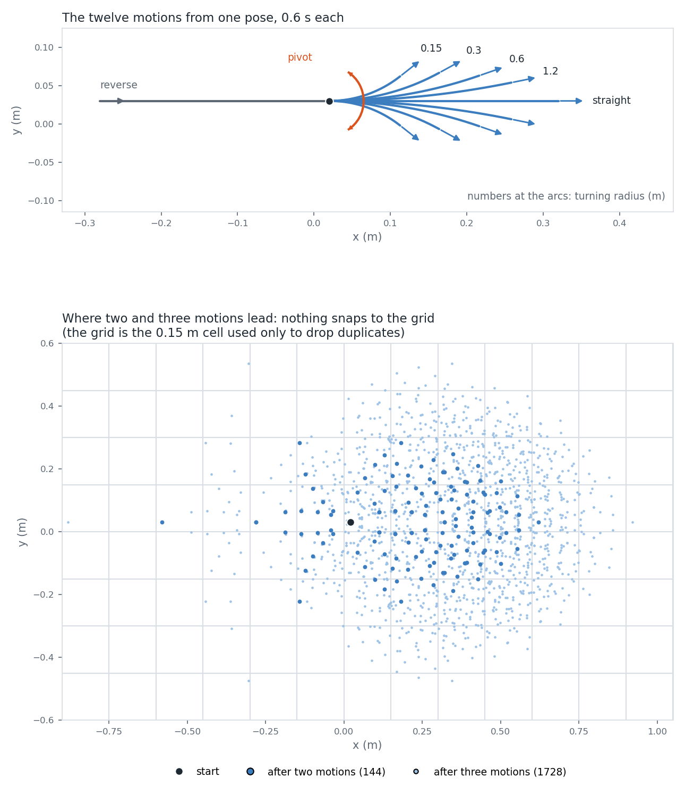

# Motion primitives

The planner does not move the robot from one grid point to the next. It applies a short control for a fixed time and sees where the robot ends up. A control is a triple `(v, ω, dt)`: forward speed in m/s, turn rate in rad/s, and a duration in s. Every motion the search considers is one of twelve such triples, built once when the planner is created.

## The twelve motions

Three numbers from the robot configuration set them all: the top speed `vmax` (m/s), the minimum turning radius `rmin` (m) and the duration `T`, which is `atomic_time` (s). `DiffDrivePrimLib::buildControlSet` makes two straights, forward and reverse, `(±vmax, 0, T)`. It then makes a left and a right turn for each radius `R` in `{0, rmin/2, rmin, 2·rmin, 4·rmin}`:

```
v = vmax · R / (R + rmin)        ω = ±vmax / (R + rmin)        dt = T
```

That is 2 + 5·2 = 12 motions. `R = 0` gives `v = 0`: a pivot on the spot. Every motion satisfies `|v| + rmin·|ω| = vmax`, so `rmin` converts turning rate into speed and the faster a motion turns, the slower it travels. Arcs only go forward; reversing is straight only.



*Top: the twelve motions from one pose, 0.6 s each. Reverse is grey, the pivot is orange, the arcs are labelled with their turning radius, and each arrow is drawn just past the end of the motion and shows the heading there. Bottom: where two motions lead (144 sequences, dark dots) and three (1728, light dots), drawn over a 0.15 m duplicate grid. The dots are a cloud, not a lattice.*

For the shipped robot (`vmax` 0.5, `rmin` 0.3, `T` 0.6, 16 heading bins):

| Motion | v (m/s) | ω (rad/s) | Turn | Cost (m) |
|---|---|---|---|---|
| straight, forward or reverse | ±0.5 | 0 | 0 | 0.300 |
| pivot | 0 | 1.667 | 57.3° | 0.300 |
| arc, R = 0.15 m | 0.167 | 1.111 | 38.2° | 0.224 |
| arc, R = 0.30 m | 0.250 | 0.833 | 28.6° | 0.212 |
| arc, R = 0.60 m | 0.333 | 0.556 | 19.1° | 0.224 |
| arc, R = 1.20 m | 0.400 | 0.333 | 11.5° | 0.247 |

Each turning motion also exists mirrored, with `ω` negated. Checked by `ControlSet.hasTwelveControls`, `ControlSet.exactlyTwoStraightsAtPlusMinusVmax`, `ControlSet.pivotInPlaceIsPresent`, `ControlSet.midRadiusArcMatchesHandComputedVelocities` and `ControlSet.isMirrorSymmetricInOmega` (`src/path_planner/test/unit/core/planner/primitives/build_diff_prim_lib_test.cpp`). They use a test robot with different numbers and check the count, the straights, the pivot, the `R = rmin` arc and the left-right symmetry. No test checks the other three radii or `|v| + rmin·|ω| = vmax` directly; the table is the formula evaluated by hand.

## Cost

```
cost = sqrt(v² + rmin²·ω²) · dt
```

This is `VelWeightedEuclideanSE2`, built by `makeControlCost` with the weight set to `rmin`. It combines the distance travelled and the angle turned, with the turn weighted by `rmin` so that both are in metres. Because of the relation above, a straight and a pivot both cost `vmax·T` (0.30 m here), and the arcs fall between 0.21 and 0.25 m.

Checked by `VelWeightedEuclidean.combinedControlIsWeightedArcLength` and `MakeControlCost.setsRotationalWeightToRmin` (`src/path_planner/test/unit/core/motion/distance_functions_test.cpp`), and `BuildPrimitive.threadsEndpointAndCostFromCollaborators` for the cost stored in each primitive.

## Applying a motion

From a state `(x, y, θ)`, `DiffDriveStateSpace::propagate` computes the displacement in the robot's own frame, rotates it by `θ` and adds it:

```
ω = 0:   dx = v·dt            dy = 0
ω ≠ 0:   dx = R_c·sin(ω·dt)   dy = R_c·(1 - cos(ω·dt))        R_c = v/ω

x' = x + cos θ · dx - sin θ · dy
y' = y + sin θ · dx + cos θ · dy
θ' = θ + ω·dt
```

Nothing is rounded. The heading is not wrapped here; it is wrapped when it is turned into a bin. Each primitive also stores the displacement it produces from heading 0 (`endpoint_offset`), but the search calls `propagate` on the actual state rather than using it.

Two motions in a row from one pose give 12² = 144 sequences and three give 1728. A few end at the same state (forward then reverse, or a left pivot then a right pivot), so the distinct states are 141 and 1620. None of them sits on a grid point, which is what the lower panel shows.

Checked by `DiffDrivePropagate.quarterCircleLeftTurn`, `DiffDrivePropagate.pureRotationInPlace` and the properties `DiffDrivePropagateProp.translationEquivariance` and `DiffDrivePropagateProp.rotationEquivariance` (`src/path_planner/test/unit/core/motion/kinematics/diff_drive_test.cpp` and `diff_drive_property_test.cpp`). The last asserts that turning the start by `φ` turns the displacement by `φ`. The counts come from the figure's data and have no test.

## Why this is not a lattice

A state lattice only allows motions that start and end on grid points. In return it gives exact duplicate detection, because two paths either reach the same point or they do not, and it lets the collision data for a motion be computed once and reused everywhere. The cost is that every motion has to fit the grid, and for a robot that can pivot on the spot that throws away most of what it can do. I wanted to keep the natural continuous motion of the robot, so the state is never snapped.

## Where a grid does appear

Two places, and neither changes a state.

The first is dropping duplicates. Without it the search would treat nearly every state as new, because two different sequences of motions almost never end at exactly the same continuous state, and the number of states grows twelvefold with every step. `HybridAstar::closedStride` turns the configured `closed_cell_size` into a whole number of map cells, and `HybridAstar::keyOf` maps a state to a key:

```
stride = max(1, round(closed_cell_size / h))
key    = (floor(i / stride), floor(j / stride), k)
```

`(i, j)` is the map cell of the state and `k` its heading bin. A candidate is dropped, when it is generated or later when its turn to be expanded comes, if an expanded state with the same key already has a cost no higher, unless the candidate satisfies the goal. The state itself is kept as it is; only the lookup is coarse. The map resolution `h` comes from the map, not from the planner configuration. On a 0.05 m map, which is what the shipped SLAM settings produce, the shipped 0.15 m duplicate cell gives a stride of 3.

`HybridAstarPlanStats.duplicateSkippedIsPositiveOnARevisitingSearch` shows that candidates are dropped. I did not find a test that pins the comparison or the goal exception on their own. `HybridAstarClosedCell.strideOneReproducesMapResolutionKeyAndIsDeterministic` and `HybridAstarClosedCell.coarseningRaisesCostMonotonicallyWithinLooseBoundAndCutsExpansions` (`src/path_planner/test/unit/core/planner/hybrid_astar/search_test.cpp`) cover the effect: a stride of 1 reproduces the map-resolution key and replans identically, and a coarser cell never lowers the cost, stays within 1.5 times the baseline and expands fewer nodes.

The second is the heading bins, and with them the per-bin footprint cache described in [the swept-cell cover](swept-cover.md).

### The straight-length check

A straight move has to be longer than the diagonal of a duplicate cell, or it could end in the cell it started in and be dropped as its own duplicate. `buildHybridAstar` requires

```
vmax · T  >  √2 · stride · h
```

and throws `std::invalid_argument` otherwise. The check runs when the planner is built for a map, because the bound depends on the map resolution. Shipped: 0.30 m against 0.212 m. Checked by `HybridAstarBuild.straightPrimitiveLongerThanRootTwoEffectiveCellBuilds` and `HybridAstarBuild.straightPrimitiveNotLongerThanRootTwoEffectiveCellThrows` (`src/path_planner/test/unit/core/planner/hybrid_astar/search_test.cpp`), which try lengths just either side of the bound, and by `BuildHybridAstar.shippedConfigBuilds` (`build_hybrid_astar_test.cpp`, same folder) for the shipped values on a 0.05 m map.

## Heading bins

With `N` bins the width is `Δ = 2π/N`, 22.5° for the shipped 16:

```
k = floor((wrapToPi(θ) + π) / Δ)        bin k starts at -π + k·Δ
```

`DiffDrivePrimLib::headingBin` computes it. Exactly `θ = π` would give `k = N`, which is wrapped to 0, since `-π` and `π` are the same direction. The footprint cache and the duplicate key must agree on which bin a heading is in, and they do: the bin that selects the cached cells and the bin in the duplicate key are the same value, returned by this function. Floor is not a free choice: the cover argument in [the swept-cell cover](swept-cover.md) is built on it and does not hold with rounding to nearest.

Checked by `HeadingBin.seamsAnchorsAndCentersForEightBins` and the properties `HeadingBinProp.invertsBinAnchoring`, `HeadingBinProp.is2PiPeriodic` and `HeadingBinProp.alwaysInRange` (`src/path_planner/test/unit/core/planner/primitives/build_diff_prim_lib_test.cpp` and `build_diff_prim_lib_property_test.cpp`).

## Limits

The straight-length check covers only the straight motion. Nothing checks that an arc or a pivot ends with a different duplicate key from the one it started with. If one did not, that motion would be dropped as a duplicate of its own start, unless it reached the goal.

On the shipped values this cannot happen, and I checked every motion. The pivot and the arcs of radius 0.15 m and 0.30 m turn by more than the 22.5° bin. The arc of radius 1.20 m moves 0.240 m (chord `2R·sin(ω·dt/2)`), more than the 0.212 m cell diagonal. The arc of radius 0.60 m is the close one: it moves 0.199 m (chord) and turns 19.1°, each under its threshold. It still changes key, because the headings that would keep it in the cell (about 32° to 39° past a multiple of 90° for the left arc) are never the headings that would keep it in the bin (within 3.4° above a bin edge). That is a property of these numbers, not something the code enforces. With another radius, duration, bin count or cell size an arc could keep its key. That would cost the search some options near certain poses; it would not make a path unsafe.

To redraw the figure, see "Redraw the primitives figure" in [the tools page](../../src/path_planner/tools/viz/README.md).
