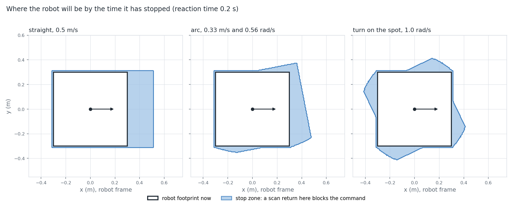

# The scan safety guard

The follower drives a path the planner checked against a map. The map can be old, the localisation can be off, and something can step in front of the robot. The scan safety guard is the last line before the wheels. It looks at the newest laser scan, works out where the robot will be by the time it has stopped, and blocks the command if a scan return is in that area. The guard holds the robot once it has blocked enough commands in a row.

## What the guard is

`ScanSafetyGuard` (`src/path_planner/include/ros/safety/scan_safety_guard.hpp`, `src/path_planner/src/ros/safety/scan_safety_guard.cpp`) subscribes to `cmd_vel_in` and `scan` and publishes `cmd_vel`. For each command it either passes it on unchanged or publishes zero. It never changes a command and it never backs the robot out.

It uses only the scan, the footprint and the static transform from the lidar frame to the robot frame. There is no map, no odometry and no localisation, so it keeps working when those are wrong. The test that runs it end to end has no `map` frame in its transform tree at all.

The decision is made by `motionBlocked` (`src/path_planner/include/core/control/stop_zone.hpp`, `src/path_planner/src/core/control/stop_zone.cpp`), a plain function with no ROS in it. The node adds timing and the hold logic around it.

## The stop zone

For a command `(v, ω)` the zone is the area the footprint covers while the robot stops, in four parts:

```
1. reaction:    constant (v, ω) for t_r
2. both brake:  for min(τ_v, τ_ω),      τ_v = |v| / linear_decel,   τ_ω = |ω| / angular_decel
3. the slower axis finishes braking, for |τ_v − τ_ω|
4. pad:         constant (v, ω) for forward_pad / S,     S = |v| + r_out·|ω|
```

`r_out` is the outer radius of the footprint, so no point of the footprint moves faster than `S`. Linear and angular speed brake independently at their own rates. A command is blocked when a scan return is inside the footprint grown by `side_pad` at one of the poses the function samples along this motion, the present pose included. A zero command is never blocked.

Straight ahead this reduces to a distance past the front edge:

```
reach = v·t_r + v² / (2·linear_decel) + forward_pad
      = 0.5·0.2 + 0.25 / 3 + 0.02 = 0.203 m
```

with the shipped `linear_decel` 1.5 m/s², `angular_decel` 2.5 rad/s², `forward_pad` 0.02 m and `side_pad` 0.01 m, at 0.5 m/s and a 0.2 s reaction time. With the front edge at 0.30 m and the side pad, a single return blocks up to 0.513 m ahead of the centre. Evaluated with the real function on a 5 mm grid the on-axis limit comes out at 0.51 m.



*Three commands of the same robot with a 0.2 s reaction time: straight at 0.5 m/s, an arc at 0.33 m/s and 0.56 rad/s, a turn on the spot at 1.0 rad/s. The white square is the footprint now, which is part of the zone; the blue area is the rest of the stop zone from the real function, evaluated for single points on a 5 mm grid.*

Checked in `src/path_planner/test/unit/core/control/stop_zone_test.cpp`. `StopZone.straightBoundaryInclusive` puts a return 1 µm either side of 0.3 + 0.2·0.5 + 0.25/3 + 0.02 + 0.01 and asserts the inner one blocks and the outer one does not. `StopZone.zeroReactionTimeFrontLimit` and `StopZone.zeroForwardPadFrontLimit` bracket the limit within 2 mm with the reaction time and the forward pad set to zero. `StopZone.pivot` asserts a return at 0.33 m blocks a 1.0 rad/s turn and one at 0.36 m does not. `StopZone.zeroCommandIsClear` covers the zero command.

## The reaction time

The reaction time is not configured. `ScanSafetyGuard::reactionTime` measures it:

```
t_r = scan age + stop_count · command period
```

The scan age is the larger of the time since the scan's stamp and the time since it arrived, clamped to `[0, stale_scan_timeout]`. The command period is the measured gap between the last two commands. If it has not been measured yet, or is outside `(0, stale_scan_timeout]`, it counts as `stale_scan_timeout`. A slow scan or a slow command stream therefore lengthens the zone by itself, up to a cap: the largest `t_r` the formula gives is 1.5 s on the shipped settings, and a command stream slower than 0.5 s is counted as 0.5 s.

Nothing tests `reactionTime` or `scanAge` directly. The integration test `test_case_10_future_stamped_scan_still_goes_stale` in `src/path_planner/test/integration/ros/scan_safety_guard_test.py` covers the arrival-time half of the age: scans stamped 5 s ahead still go stale. The rest of the formula is untested.

## Why the check is a cover

`motionBlocked` does not solve for the zone. It advances the pose through the four parts in steps and tests every scan return against the footprint, grown by `side_pad`, at each pose:

```
n·q ≤ d + side_pad        for every edge of the footprint
```

`n` is the outward edge normal, `d` its offset, and `q` the return in the footprint's frame at that pose. The number of steps in a part of duration `T` is

```
steps = max(1, ceil(S·T / side_pad))
```

so between two samples no footprint point moves more than `side_pad`. The part where both axes brake uses the larger of that and `ceil(sqrt((|v|·angular_decel + linear_decel·|ω|)·T³ / (6·side_pad)))`. The second term bounds the position error of advancing with mid-step speeds while both speeds change, to half of `side_pad` (the heading is exact). The other half covers the travel to the nearer sample. On the shipped settings the first count is always the larger one.

The padding is what makes the samples cover the motion between them, and two things follow.

1. For a robot that brakes each axis at exactly the configured rate, every point the footprint touches during the modelled stop is reported.
2. A reported point lies within `side_pad·(1/sin(a/2) + 1/2)` of the footprint at some instant of the modelled motion, where `a` is the footprint's smallest interior angle; `1/sin(a/2)` is the corner of the grown footprint and `1/2` is the position error just described. For a rectangle that is 1.914·`side_pad`, 0.019 m on the shipped settings.

Points on the boundary count as inside. The pad is not a sensor-noise allowance.

Checked in `src/path_planner/test/unit/core/control/stop_zone_property_test.cpp`, against an independent RK4 integration of the braking profile.

- `StopZoneProperty.everyPointTouchedDuringTheStopIsBlocked` picks a random command, a random point on the footprint boundary and a random time in the reaction and braking phases, moves the point to where it is at that time, and asserts it is blocked. `StopZoneProperty.everyPointTouchedDuringTheStopIsBlockedLargeSidePad` does the same with `side_pad` between 0.5 and 2 m and both decelerations between 0.2 and 4. `StopZoneRegression.fastArcVerticesBlockedThroughoutStop` asserts all four vertices are blocked every 5 ms through the stop of a fast arc (0.27 m/s, 1.83 rad/s).
- `StopZoneProperty.coversUnpaddedFootprint` asserts that a point inside the unpadded footprint, at any time of the whole motion including the pad part, is blocked.
- `StopZoneProperty.blockedImpliesWithinPaddedFootprint` asserts that a blocked point is within `side_pad·(1/sin(π/4) + 1/2)` of the footprint at some oracle pose. The bound has one more term, `S` times the largest time spacing of the oracle, because the oracle is itself sampled.
- `StopZoneProperty.blockedImpliesWithinReachBound` asserts a blocked point is no farther from the centre than `0.31·√2 + |v|·(t_r + max(|v|/(2·linear_decel), |ω|/(2·angular_decel))) + forward_pad`.

## Engaging and releasing the hold

`onCmdVelRaw` counts. The hold engages after `stop_count` blocked commands in a row (shipped 2) and releases after `clear_count` clear commands in a row (shipped 10). Until it engages, blocked commands go through. While it holds, the guard publishes zero velocity on every command.

Three cases skip the counting and publish zero at once, resetting both counters and starting a hold: no scan has ever been accepted (a scan counts only after its transform into the robot frame succeeded), the newest scan is older than `stale_scan_timeout` (shipped 0.5 s), or the node clock has stepped back past the scan's arrival time. After one of these the hold needs `clear_count` clear commands to release. A command that is not finite counts as blocked and is never passed on: zero is published in its place at once.

A zero command always counts as clear, so `clear_count` zero commands in a row release the hold even if the return is still there. The next non-zero command is tested again.

The scan is transformed into the robot frame once per scan message, with the transform at the scan's stamp if it is available and the latest one otherwise. If the lookup fails the previous scan stays in use until it goes stale. Returns that are not finite, or outside `[range_min, range_max]`, are dropped. The transform is treated as a planar offset and yaw; height, roll and pitch are ignored.

All the settings are in `src/path_planner/config/safety/scan_safety_guard.yaml` and are checked at load: the decelerations and `side_pad` must be positive, `forward_pad` non-negative, the counts at least 1, the timeouts positive.

Checked in `src/path_planner/test/integration/ros/scan_safety_guard_test.py`, which runs the node against a fake scan and command publisher. `test_case5_stale_scan_failsafe_stops` stops the scan and asserts the output goes to zero. `test_case9_resume_is_debounced` clears the scene and asserts the output stays zero for at least 8 clear commands before it resumes. `test_case1_forward_return_ahead_stops` and `test_case4_return_ahead_does_not_stop_reverse` check that a return 0.45 m ahead holds a forward command and not a reverse one. I found no test of the `stop_count` engage, of a non-finite command, of a failed transform lookup, or of the range filter.

## Limits

1. The zone is sized from the commanded velocity, not the measured one. When the follower changes from driving to turning on the spot it commands zero forward speed at once (`PurePursuit::pivotToward` returns `v = 0`), and the robot can still be rolling. The zone is then sized for a turn only.
2. A return inside the footprint grown by the side pad blocks every non-zero command, reversing away included, because the first pose tested is the present one. Measured with the tool: a single return 0.305 m ahead of the centre blocks a reverse command of 0.25 m/s, one at 0.312 m does not (front edge at 0.30 m, side pad 0.01 m). A robot that close to an obstacle is held again on the `stop_count`-th non-zero command in a row, whatever direction it is told to move, and an escape move from there stalls (see [the navigation page](navigation.md)).
3. The planner may route the footprint closer to a wall than the side pad, since it plans with the real footprint. The guard then holds the robot.
4. The model assumes the robot brakes at the configured rates, each axis independently. The two rates repeat the example robot's drive limits and nothing checks that they agree.
5. The guard sees only what the scan sees: one plane, and returns nearer than the sensor's minimum range are dropped.
6. The hold engages only on the second blocked command in a row (shipped `stop_count` 2), so one blocked command reaches the wheels each time. A command that is not a finite number is the exception: it is replaced by zero at once.

To redraw the figure, see "Redraw the stop zone figure" in [the tools page](../../src/path_planner/tools/viz/README.md).
