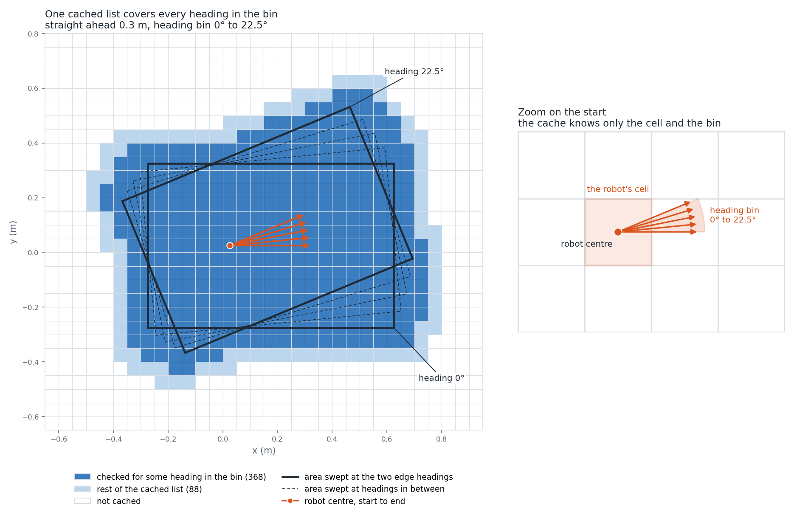

# The swept-cell cover

Checking one candidate motion honestly means placing the footprint at many poses along it and testing every cell it touches. The search has to check tens of thousands of candidate motions in a single plan (about 27 000 in the door scenario shown in the README). So for each motion and each heading bin I precompute the list of cells the footprint could touch, and at run time I shift the list by the robot's cell and look the cells up.



*Left: the shipped robot (0.6 m square, 0.05 m cells) driving straight 0.3 m from five headings across one 22.5 degree bin. Dark cells are the ones the exact check looks at for a start in the middle of the cell, at one of 17 headings across the bin (368). Light cells are the rest of the cached list (88): they cover the other positions in the cell and the margins. White cells are not cached. Right: what the cache knows about the start, which is the cell and the bin and nothing finer.* For any single one of those 17 headings the exact check looks at 287 to 315 of the 456 cached cells.

## What cover means

The cached list `swept_cells[k]` of a motion contains every cell the footprint can touch while executing that motion from any start whose position snaps to the robot's cell and whose heading falls in bin `k`. A clear list proves the motion is clear. An occupied cell in the list does not prove a collision, because the list is larger than any one sweep.

Position snaps by floor to the cell. Heading snaps to a bin:

```
k = floor((wrapToPi(θ) + π) / Δ)        bin k starts at θ_k = -π + k·Δ
```

`wrapToPi` returns a value in `[-π, π]`. The one heading that would give `k = N`, exactly `+π`, goes to bin 0, whose lower edge `-π` is the same direction.

This is `DiffDrivePrimLib::headingBin`. Nothing below works with rounding to nearest.

Notation, used throughout:

```
h      grid resolution (m)
N      n_headings, Δ = 2π/N (rad)
u      a motion (v, ω, dt) in m/s, rad/s, s
r_out  outer radius of the footprint (m): distance from the robot origin to its farthest vertex
```

## Four things the cache does not know

The cache is built once, with no map and no real start pose. Four sources of error have to be covered, and each gets its own margin.

### A. One pose onto cells

`rasterizePolygon` (and `visitPolygonCells`, which walks the same cells without building a list) takes a cell when its centre `c` passes every edge test, and the cell lies in the footprint's bounding box grown by the same amount:

```
n_k · c  ≤  d_k + (√2/2)·h + margin        for every edge k
```

Here `n_k` is the outward unit normal of edge k and `d_k` its offset. The claim: every cell that overlaps the footprint grown by `margin` is taken. A cell like that contains a point within `margin` of the footprint, and the cell centre is at most half a cell diagonal, `(√2/2)·h`, from that point. A point within distance `D` of a convex polygon is within `D` outside every edge line and within `D` of its bounding box, so the cell passes.

Checked by `RasterizeProp.footprintCoversPolygonInterior` and `RasterizeProp.marginResultIsMonotoneAndCoversOutwardPoints` (`src/path_planner/test/unit/core/map/rasterize_property_test.cpp`). The first samples points of a rectangle and asserts each lands in a returned cell. The second asserts that widening the margin only adds cells and that points up to `margin` outside each edge of a random convex polygon land in a returned cell.

### B. Time between samples

The fastest point of the footprint moves at most `|v| + r_out·|ω|`. With `n` equal time steps:

```
n   = max(1, ceil((|v| + r_out·|ω|)·dt / h))
m_s = (|v| + r_out·|ω|)·dt / (2n)            ≤ h/2
```

Any instant is within `dt/(2n)` of a sampled instant. The footprint at that instant lies within `m_s` of the footprint at the sample.

### C. Heading inside the bin

Turning the start heading by `δ` turns the whole motion about the start point. A footprint point is never farther than `|v|·dt + r_out` from the start point, so it moves at most `(|v|·dt + r_out)·δ`. With `M` heading steps across the bin, both edges included (headings `θ_k + m·Δ/M`, `m = 0..M`):

```
M   = max(1, ceil((|v|·dt + r_out)·Δ / h))
m_θ = (|v|·dt + r_out)·Δ / (2M)              ≤ h/2
```

Any heading in the bin is within `Δ/(2M)` of a sampled one.

### D. Position inside the cell

The real position is the cell's lower-left corner plus an offset in `[0, h)` on each axis. The cache is built with the robot at the corner. Shifting a set of points by such an offset moves each touched cell to itself or to its right, upper or upper-right neighbour. So every cell `(i, j)` goes in together with `(i+1, j)`, `(i, j+1)` and `(i+1, j+1)`.

## Putting them together

`DiffDrivePrimLib::buildCover` builds the list for one motion and one bin:

```
swept_cells[k] = dilate( union over m = 0..M and j = 0..n of
                   rasterize( footprint at heading θ_k + m·Δ/M and time dt·j/n,  margin = m_θ + m_s ) )
```

Take any start in the cell and bin, and any instant of the motion. Ignore the in-cell offset for a moment. The footprint there is within `m_θ` of the footprint at the nearest sampled heading (C), which is within `m_s` of the footprint at the nearest sampled time (B). So it lies inside a sampled footprint grown by `m_θ + m_s`, and every cell it touches was taken (A). Adding the offset back moves each cell by at most one step right and up (D), which the dilation covers. Both margins are checked against `h/2` when the library is built, by a `CHECK` in `buildCover`.

Checked by `SweptCover.everyTouchedCellIsCached` (`src/path_planner/test/unit/core/planner/primitives/swept_cover_property_test.cpp`). It draws a configuration, a motion, a bin, a heading inside the bin and an offset inside the cell. An independent oracle that does not use `rasterizePolygon` lists cells the footprint overlaps at closely spaced poses along the motion (it can miss a cell that is only grazed, never invent one), and the test asserts all of them are in `swept_cells[k]`. The robot shapes, resolutions and bin counts come from a short fixed list; the motion, bin, heading and offset are random.

## The price

The list is larger than any single sweep. For the shipped robot the nine forward motions cache 397 to 456 cells each; the exact check for one start pose (one pose per motion, off the cell corner and 60% across the bin) looks at 271 to 292 of them. So a blocked scan is only a suspicion.

The search does not reject such a candidate. It keeps it, marked unconfirmed (`pending_exact`), and runs the exact check over the true start pose only if the candidate is popped for expansion. If that check fails, the node is dropped without a trace in the closed set. A node that reaches the returned path has either passed the cheap tests or passed the exact check, and the straight-line shot to the goal is exact-checked segment by segment.

I give no bound on how much larger the list is. `SweptCover.everyCachedCellIsWithinReachOfTheMotion` (`src/path_planner/test/unit/core/planner/primitives/build_diff_prim_lib_test.cpp`) only checks that no cached cell is out of reach: the distance from the start cell's corner to any cached cell is at most `|v|·dt + r_out + h + (√2/2)·h + √2·h`.

## The exact check

With the true start pose, C and D vanish. `MotionContext::visitExactCover` rasterizes the footprint at `n + 1` poses `t_j = dt·j/n` with margin `m_s` (same `n` and `m_s` as B), plus the trajectory sample poses with margin 0. It stops at the first blocked cell. The exact check is still a cover, only a much tighter one: a blocked answer means an occupied cell whose centre is within `m_s + (√2/2)·h` outside every edge line of the footprint at some sampled pose, not a proven contact.

Checked by `ExactCover.everyTouchedCellIsCovered` (`src/path_planner/test/unit/core/planner/primitives/exact_cover_property_test.cpp`): for random controls, headings, in-cell offsets and grid origins, every cell the independent oracle reports is in `computeExactCover(...).cells`. `ExactCover.visitMatchesComputeAsSet` ties `visitExactCover` to that list. For agreement with the cache, `AgreementCover.everyScannedCellIsInTheCover` (`src/path_planner/test/unit/core/planner/primitives/agreement_cover_property_test.cpp`) takes the cells `rasterizePolygon` gives at each trajectory sample pose with margin 0 (what `checkState` scans) and asserts each is in `swept_cells[k]` shifted by the start cell.

## The shortcut before the scan

A motion far enough from obstacles never reads the list. Along the centre path the library stores sample cells (at the mid-bin heading) and, for each, the obstacle-free distance that makes the footprint certainly clear there. With `ρ_i` the distance of sample `i` from the start point and `σ` the centre path length between consecutive samples:

```
sample_clearance[i] = r_out + 2·ρ_i·sin(Δ/4) + 2√2·h + σ/2
```

- `r_out`: the footprint fits in a disc of that radius about the centre.
- `2·ρ_i·sin(Δ/4)`: the real heading is up to `Δ/2` from mid-bin, which moves the sample along a chord.
- `2√2·h`: three things, the start offset in the cell (`√2·h`), snapping the sample to a cell (`(√2/2)·h`) and the distance field being measured between cell centres (`(√2/2)·h`).
- `σ/2`: a centre between two samples is within half a gap of one of them.

`CollisionChecker::checkTrajectory` walks the samples in order and returns one of four verdicts. If every sample's distance-field value `edt` is above its clearance, the motion is clear with no scan (`FAST_ACCEPT`). A sample with `edt + (clearance - r_out) < r_in` returns `FAST_REJECT` at once: `r_in` is the inner radius, and an occupied cell that close to the sample is inside the footprint for every start in the cell and bin. The first sample that is off the grid, or that decides neither way, ends the walk and sends the check to the cell scan, which returns `SCAN_CLEAR` or `SCAN_BLOCKED`; later samples are not examined.

Checked by `CollisionCheckerProp.fastVerdictsAgreeWithCellsAndGeometry` (`src/path_planner/test/unit/core/collision_checker/collision_checker_property_test.cpp`). It scatters obstacles near the node and near the clearance threshold. Whenever the verdict is `FAST_ACCEPT` or `FAST_REJECT`, it picks a start inside the cell and bin and asserts through the independent oracle that no touched cell is occupied (accept) or at least one is (reject).

## The start gate

The planner refuses a start that is too close to an obstacle and returns `StartBlocked`. `CollisionChecker::startClear` uses the distance

```
m = (√2/2 + 1/2)·h
```

which is formula A with `margin = h/2`, the largest value `m_s` can take (B). So the cells the gate examines contain the cells the exact check examines at its first pose, for every motion, provided the collision checker and the planner's `MotionContext` use the same grid origin, resolution and footprint, which `buildHybridAstar` arranges. A start that passes can never be rejected on its own starting pose. Without the gate, a robot parked against a wall would see every motion fail its exact check and the search would report that no path exists. That is the wrong answer. The right one is "the start is blocked", and clearing it is a separate job.

The contract, in prose: an OCCUPIED cell centre within distance `m` of the footprint always blocks. A blocked answer always has an OCCUPIED centre within `m` outside every edge line. In between, beyond distance `m` in the tip next to a footprint corner (at most `m / sin(α/2)` from the footprint for interior angle `α`, so `√2·m` for a right angle), either answer is possible, because cells come from the bounding box grown by `m`. UNKNOWN and off-grid cells never block.

Checked by `CollisionCheckerProp.startClearBracketsItsGuarantees` and `CollisionCheckerProp.startClearIsMonotoneAndImpliesCheckState` (same file as above). The first compares `startClear` with a direct computation of each occupied centre's distance to the footprint and to the edge lines, and asserts the two one-sided guarantees. The second asserts that a larger extra margin can only turn clear into blocked, and that a clear start also passes `checkState`. No test checks the containment of the first-pose cells directly; it rests on the argument above.

## Assumptions and limits

- The footprint is a convex polygon, listed counter-clockwise, with the robot origin strictly inside. `buildRobotParams` checks this and computes the unit edge normals the formulas use.
- The cache and the map have the same resolution, and the collision checker and the exact check share the grid origin and the footprint. `buildHybridAstar` checks the first and arranges the second.
- The distance field is clamped at a limit above the largest `sample_clearance`. `buildHybridAstar` stops with a message otherwise.
- Position snaps by floor and headings by floor into bins anchored at `-π`.
- The margins are bounds, not tight. I have not bounded how much larger the cached list is than a true sweep.
- The build-time checks on `m_s` and `m_θ` allow `h/2 + 1e-12`, so the start-gate argument holds up to that rounding slack.
- That the search's verdict on a motion agrees with a later re-check of the finished path is tested, not proven. `PathMonitorAgreement.everyReturnedPathIsAcceptedByTheMonitor` (`src/path_planner/test/unit/core/planner/validation/path_monitor_agreement_test.cpp`) plans on small random cluttered maps and asserts each returned path passes `pathValid`, and that a start failing `startClear` gives `StartBlocked`.
